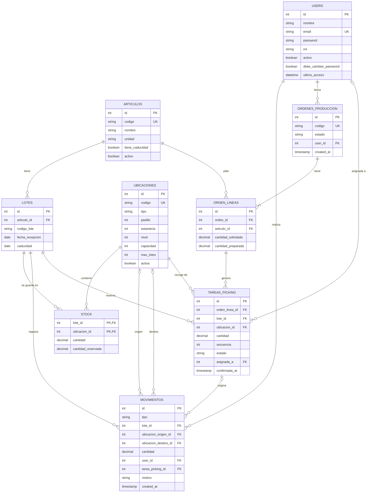

# Modelo entidad-relación

Borrador 1 (5 de noviembre de 2026). Cubre las fases iniciales: recepciones, stock, órdenes de producción y picking. GitHub renderiza el diagrama de abajo directamente.

## Notas sobre el modelo

- `stock` no tiene id propio: su clave es la pareja (`lote_id`, `ubicacion_id`), que impide duplicados. Es el saldo actual y se actualiza en la misma transacción que inserta el movimiento.
- En `movimientos`, `ubicacion_origen_id` y `ubicacion_destino_id` son opcionales a propósito. Una recepción no tiene origen y una baja no tiene destino. La cantidad siempre es positiva.
- `movimientos` es un registro inmutable: nunca se edita ni se borra. `tarea_picking_id` permite saber qué movimiento salió de qué tarea.
- La fecha de entrada (`fecha_recepcion`) y la caducidad pertenecen al lote, no al stock. Así un traslado no rejuvenece el material.
- `users` lleva además `debe_cambiar_password` (primer acceso y restablecimientos) y `ultimo_acceso`. Un usuario con `activo` a falso no puede entrar. Detalle en `docs/seguridad.md`.
- El rol es una columna de `users`, sin tabla aparte. Son cinco roles fijos: admin, gestor de inventario, operador de producción, operador de almacén y operador de recepción.
- `ubicaciones.max_lotes` (por defecto 1) y `ubicaciones.capacidad` regulan cuántos lotes y cuánta cantidad admite cada ubicación.
- `tareas_picking` se crea al lanzar una orden y reserva lotes por FEFO. `ordenes_produccion.estado` y `tareas_picking.estado` están descritos en `docs/diseno.md`.

## Fuera de este borrador

Conteos cíclicos y sus líneas, incidencias como entidad propia, configuración del sistema (fecha simulada) y stock mínimo con avisos de reposición.
